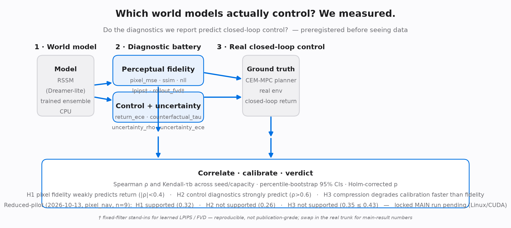

# Which world models actually *control*? We measured.



**WM-Audit** is a preregistered, single-machine CPU audit suite that disentangles
world-model **perceptual fidelity** (next-frame MSE / SSIM / NLL, plus
fixed-filter stand-ins† for LPIPS / rollout FVD) from **control utility**
(does the model let a planner actually solve the task?).

> *Everyone is building bigger world models; almost no one is checking whether
> the ones we have actually control. We measured it.*

---

## Research question

World models are trained, selected, and reported on pixel fidelity (MSE / NLL /
FVD). But planners *consume* counterfactual action effects and reward
predictions. **Do the diagnostics we report predict closed-loop control?**

We run a battery of diagnostics on each world model, measure the *real*
closed-loop return, then correlate every diagnostic with the return across
seed/capacity — with percentile-bootstrap 95% CIs and Holm-corrected p-values,
all preregistered before seeing data.

| | Diagnostic | What it tests |
|---|---|---|
| Perceptual | `pixel_mse`, `pixel_ssim`, `pixel_nll`, `pixel_lpips`†, `rollout_fvd`† | next-frame / rollout image fidelity |
| Control | `return_ece`, `counterfactual_tau` | imagined-vs-real return calibration; (s,a1,a2) action ordering |
| Uncertainty | `uncertainty_rho`, `uncertainty_ece` | does ensemble dispersion track the true error? |

> † **`pixel_lpips` / `rollout_fvd` are fixed-filter stand-ins, not learned perceptual backbones.** They are computed by a deterministic, dependency-free bank of seeded random convolution filters (`wm_audit.diagnostics.perceptual.FixedFilterFeatures`) standing in for the pretrained VGG/AlexNet trunk behind real LPIPS and the feature distribution behind real FVD. The numbers are real and reproducible (no mock), but they are **not** publication-grade learned LPIPS/FVD — do not over-read them as such. Swap in the real `lpips` trunk for main-result numbers.

`counterfactual_tau` is operationalized as the **global pooled Kendall-τb**: at
each sampled state we step two candidate actions in the oracle env and through
the model (one-step rewards), then pool *all* `(state, action)` triples across
states into one two-sample series and compute a single tie-aware Kendall-τb
between oracle and imagined rewards. It is **not** a per-state sign-agreement
rate / fraction of states where the two actions are ordered correctly.

**Ensemble convention (consistent).** The pixel and uncertainty diagnostics
already averaged per-member values across the ensemble. The control battery
(`return_ece`, `counterfactual_tau`) is now on the same footing: each is computed
*per member* on the identical segments/states and averaged across members, rather
than silently using only the lead member.

**Which rows enter which test.** H1/H2 ask which diagnostics predict closed-loop
return *across model capacity*, so their oriented-rank composites and every
Spearman correlation are computed on the **float baseline rows only**
(`[r for r in rows if not r['compression']]`). Compression-tagged rows (e.g.
INT8) are the *same already-trained ensemble* under a deployment perturbation — a
near-duplicate of a float baseline, not a new capacity tier — so they belong only
to H3. They are still shown in the leaderboard Rows table, but never enter the
H1/H2 correlation pool. H3 pairs each INT8 row with its float baseline on the
exact `(hidden, embed, seed)` triple, and measures degradation on a **fixed
reference ladder** locked to the float baseline set: each compressed row's
diagnostic values are *inserted* into the fixed float reference distribution
(competition/insertion rank), so adding or removing another compression lever
cannot shift a shared pair's degradation.

**Modeling scope: recurrent state is reset every batch (no learned temporal
dependency).** During training (`wm_audit/train/train_wm.py`) the GRU hidden
state is re-initialized to zeros at every training step
(`h = model.init_state(batch_size)`); transitions are never unrolled into
sequences, so the GRU's recurrent carry-over is never trained. Despite the
RSSM/GRU wiring, the stand-in model is effectively a per-transition feedforward
mapping. This pilot's H1/H2/H3 conclusions describe **only this single-step
stand-in pipeline** and must NOT be extrapolated to a genuine recurrent world
model with learned temporal dynamics.

**`pixel_nll` uses one scalar global logvar (weak approximation).** The
probabilistic head (`wm_audit/models/dreamer_lite/rssm.py`) keeps a single
shared `logvar` parameter for every pixel instead of a per-pixel/per-channel
variance head; `gaussian_nll` therefore reports a homoscedastic, all-pixels-
shared NLL. It is a coarse fidelity signal for cross-config comparison, not a
full heteroscedastic per-pixel likelihood.

## Preregistered hypotheses (see `configs/preregistration.yaml`)

- **H1** — pixel fidelity *weakly* predicts closed-loop return:
  `|ρ(pixel, R_real)| < 0.4`. (A falsification is still published as a bounded result.)
- **H2** — control-relevant diagnostics strongly predict return: `ρ > 0.6`.
- **H3** — compression (INT8 / prune / distill) degrades calibration and
  uncertainty alignment *faster* than raw pixel fidelity.

## Status (honest)

- ✅ **Implemented and CI-tested**: stats core (Spearman / Kendall / bootstrap /
  Holm), the diagnostic battery, a deterministic built-in env, replay buffer, a
  tiny CPU RSSM, CEM-MPC close-loop, and INT8 quantization parity.
- 🧪 **Preregistered CPU reduced pilot executed (2026-10-13); the locked MAIN
  run has NOT been executed.** The committed numbers in `leaderboard/LEADERBOARD.md`
  come from this reduced pilot only: env `pixel_nav` only (the 2nd prereg env
  `dm_control.cartpole_swingup` cannot install on Windows: `labmaze` needs
  `bazel`); 3 seeds × 3 capacities (n=9 float rows), INT8 lever,
  `bootstrap=2000`. Verdicts (mechanical threshold rule as preregistered):
  **H1 threshold met — but only a weak / tentative exploratory signal**:
  |ρ(pixel_composite,R)|=0.317<0.4 on n=9, yet the 95% CI [−0.947, 0.554]
  crosses zero, p_raw=0.406, Holm-adj p=1.000 → **not statistically
  significant, NOT an established finding** (see "Limitations" below);
  **H2 not supported** (ρ(control_composite,R)=0.26<0.6), **H3 not supported**
  (INT8 control-deg 0.35 ≤ pixel-deg 0.43, n_pairs=9). This is a *reduced pilot*,
  not the locked 200k-step × 5-seed × 2-env main: seeds 3 (goal 5),
  `train_steps=12000` (goal 200000) for CPU wall-clock; see the config comment block.
- 🚧 **Locked MAIN run pending (requires Linux/CUDA)**: the preregistered
  200k-step × 5-seed × 2-env main has not been executed; no main numbers exist
  and none are claimed beyond the reduced-pilot measurements above.

## Limitations (read before citing any verdict)

**1. The H1 "support" is a threshold-rule label, not an established finding.**
On the n=9 float rows the preregistered threshold rule fires
(|ρ(pixel_composite, R_real)| = 0.317 < 0.4), but the evidence behind it is
weak: the percentile-bootstrap 95% CI [−0.947, 0.554] crosses zero, the
uncorrected p_raw = 0.406, and after Holm correction p_adj = 1.000. At n=9 the
interval is equally compatible with a moderate positive and a moderate negative
correlation. Treat this as a **tentative / weak exploratory signal** to be
confirmed or overturned by the locked main run — never as "we found that pixel
fidelity predicts control".

**2. The diagnostic battery is NOT independent evidence at n=9.** Five of the
eleven diagnostics — `pixel_mse`, `pixel_nll`, `pixel_lpips`†, `rollout_fvd`†,
`uncertainty_ece` — produce **identical Spearman ρ = 0.3167 and identical
p_raw = 0.4064** against R_real on the 9 float rows (same CI [−0.554, 0.947]):
their 9-element rank vectors are exactly collinear. They are therefore *one*
rank pattern, not five independent confirmations; "the battery" at n=9 carries
far fewer independent signals than its 11 diagnostics suggest, and
multi-diagnostic agreement must not be counted as cross-validation. The likely
driver is the tiny n=9 combined with deterministic, capacity-ordered stand-in
models (a scalar-logvar NLL head and a fixed, pre-defined filter bank leave
little independent variation between pixel metrics). This will be re-checked on
the main run; on this pilot it is a confound, not a result.

**3. Already-disclosed scopes that further bound every verdict:** single-step
feedforward stand-in (GRU state reset every batch — no learned temporal
dynamics); scalar homoscedastic `pixel_nll`; fixed-filter stand-ins for LPIPS /
FVD (not learned backbones); `pixel_nav` env only; CPU, `train_steps=12000`
(prereg 200000), 3 seeds (prereg 5). No main-run number exists; nothing here is
extrapolated to a recurrent world model or to `dm_control`.

## Environment

The committed numbers in `leaderboard/results_main.json` come from a **CPU-only,
single-machine reduced pilot**. They were produced in the exact environment
below; see `requirements-lock.txt` for the machine-readable pins.

| Component | Pinned version |
|---|---|
| OS | Windows 11 (64-bit, x86-64) |
| Python | CPython 3.13.x (64-bit) |
| torch | **2.14.1+cpu** (CUDA disabled; `torch.cuda.is_available() == False`) |
| numpy | 2.5.4 |
| scipy | 1.18.1 (installed, but **not imported** by the audit - stats are hand-rolled) |
| pyyaml | 6.0.3 |

To reproduce that environment:

```powershell
python -m venv .venv
.\.venv\Scripts\activate
pip install -r requirements-lock.txt   # exact pins; torch resolves to the +cpu wheel
pip install -e .
```

> **Honest bit-reproducibility caveat.** The rows are seeded and the stats
> pipeline is deterministic, but torch CPU BLAS kernels, the BLAS vendor, and
> OS/architecture can still shift the *last digits* of floating-point results
> across machines, torch builds, or numpy versions. We therefore do **not**
> claim bit-for-bit equality on a different OS / BLAS / torch build. What we do
> claim is **robustness of the conclusions**: at n=9 the preregistered verdicts
> are threshold / sign decisions (|ρ|=0.32<0.4 meets the H1 threshold; ρ=0.26<0.6
> rejects H2; INT8 control-deg 0.35 ≤ pixel-deg 0.43 rejects H3), and none of
> these flip on sub-permille float reordering. Note that "meets the H1
> threshold" is a mechanical label only — it carries **no** statistical
> significance at n=9 (CI crosses zero, Holm-adj p=1.0; see Limitations).
> The lock pins the exact tested build so a
> re-run *in this environment* matches the printed precision.

## Quickstart

```powershell
python -m venv .venv
.\.venv\Scripts\activate
pip install -r requirements-lock.txt   # exact CPU pins (see Environment above)
pip install -e ".[dev]"

pytest                                  # unit tests + CI smoke (must stay green)
python -m experiments.run_audit         # == --mode smoke: n=6 CI placeholder (CPU, ~6-7 min)
                                        # default output: gitignored .tmp/results_smoke.json;
                                        # it NEVER overwrites the tracked leaderboard/results_smoke.json.
                                        # This is NOT the committed n=9 pilot - see
                                        # "Reproducing the n=9 reduced pilot" below.
python experiments\make_leaderboard.py   # render leaderboard/LEADERBOARD.md
```

A bare `python -m experiments.run_audit` (equivalent to `--mode smoke`, n=6)
writes to the gitignored `.tmp/` scratch path by default (see
`experiments/run_audit.py`); the committed `leaderboard/results_smoke.json` is
preserved history and is only rewritten when you pass an explicit `--out`.

## Reproducing the n=9 reduced pilot

There are **two distinct modes** - do not confuse them:

| Mode | What it is | n (float rows into H1/H2) | Seeds | train_steps | bootstrap |
|---|---|---|---|---|---|
| `--mode smoke` | CI / quick sanity placeholder | **n=6** | 2 | 150 | 200 |
| `--mode main` | the **committed reduced pilot** (`leaderboard/results_main.json`) | **n=9** | 3 | 12000 | 2000 |

`--mode smoke` is a tiny CI placeholder with its own, meaningless verdicts; it
is *not* a shorter run of the pilot. The tracked `leaderboard/results_main.json`
was produced by `--mode main`.

To regenerate the committed pilot numbers (CPU only; this is the reduced pilot,
**not** the locked 200k-step × 5-seed × 2-env main - see Status):

```powershell
# from the repo root, with the locked venv activated:
python -m experiments.run_audit --mode main --out leaderboard/results_main.json
python experiments\make_leaderboard.py   # re-render leaderboard/LEADERBOARD.md from the JSON
```

- **Wall-clock (estimate, not measured):** no timer was logged during the
  2026-10-13 pilot. From the recorded CPU throughput of ~236 member-steps/s and
  the pilot's 9 configs × 3 ensemble members × 12000 train steps (~324k
  member-steps) plus data collection, CEM closed-loop rollouts, and a
  2000-resample bootstrap, expect on the order of **~25-35 minutes on a
  comparable CPU**. (For reference, `--mode smoke` measured ~396 s / ~6.6 min on
  this machine.) Treat both numbers as estimates, not guarantees.
- **Expected output** (`leaderboard/results_main.json`): 18 rows = 9 float
  baselines + 9 INT8 pairs across 3 seeds × 3 capacities; the H1/H2 correlations
  are computed on the **n=9 float rows only** (INT8 rows enter H3 only).
  Verdicts - **H1 threshold met: weak / tentative exploratory signal only**
  (|ρ(pixel_composite, R_real)| = 0.317 < 0.4, but n=9, CI [−0.947, 0.554]
  crosses zero, p_raw=0.406, Holm-adj p=1.000 → not significant),
  **H2 not supported** (ρ(control_composite, R_real) = 0.259 < 0.6),
  **H3 not supported** (INT8 control-composite degradation 0.352 ≤ pixel-composite
  degradation 0.433, n_pairs=9). Re-running inside the locked environment
  reproduces these values to printed precision; see the bit-reproducibility
  caveat under Environment.

The built-in `pixel_nav` env makes the whole chain run on CPU without
`dm_control`. Heavy envs (`dm_control.cartpole_swingup`, Atari) live behind
optional extras.

## Repository layout

```
configs/         preregistration.yaml + env / wm / audit configs
wm_audit/
  stats/         Spearman, Kendall tau-b, bootstrap CI, Holm (numpy, tested)
  diagnostics/   perceptual / control / uncertainty / fidelity_utility
  envs/          unified reset/step interface; built-in pixel_nav (+ optional dm_control)
  data/          replay buffer + intervention perturbations
  models/        dreamer_lite RSSM (CPU)
  train/         collection + ensemble training
  policy/        CEM-MPC close-loop
  deploy/        INT8 quantization parity (RQ3 axis)
experiments/     run_audit.py (entry), make_leaderboard.py
notebooks/       10min_audit.ipynb
tests/           unit + smoke (CI must pass)
leaderboard/     placeholder (LEADERBOARD.md)
```

## Mutation checks

Two tests are deliberately wired so that a broken implementation turns them red:
`test_calibration.py::test_offset_increases_ece_monotonically` (ECE must grow
with systematic offset) and `test_spearman_bootstrap.py::test_bootstrap_ci_covers_known_truth`.
We verified both go red when the underlying math is broken.

## References

WM-Audit is a measurement layer on top of the following world models and
recent audit-adjacent work. (IDs verified against arXiv abstract pages; the
numbers in this repo come from the preregistered CPU reduced pilot on `pixel_nav`
plus a downgraded CI smoke placeholder. The locked 200k-step × 5-seed × 2-env
MAIN run has NOT been executed; it requires Linux/CUDA.)

- **DreamerV3** — D. Hafner, J. Pasukonis, J. Ba, T. Lillicrap.
  *Mastering Diverse Domains through World Models.* arXiv:2301.04104.
- **TD-MPC2** — N. Hansen, H. Su, X. Wang.
  *TD-MPC2: Scalable, Robust World Models for Continuous Control.* arXiv:2310.16828.
- **Validate the Dream** — C. Oefinger et al.
  *Validate the Dream Before You Trust Its Verdict: Admissibility for World-Model
  Simulators.* arXiv:2607.07196. (Venue/workshop affiliation not independently
  verified; cited by arXiv ID only.)
- **Biased Dreams** — J. Berger, B. Frauenknecht, S. Trimpe, B. Leibe.
  *Biased Dreams: Limitations to Epistemic Uncertainty Quantification in Latent
  Dynamics Models.* arXiv:2604.25416. (Venue affiliation not independently
  verified; cited by arXiv ID only.)
- **stable-worldmodel** — L. Maes et al., incl. Y. LeCun, R. Balestriero.
  *stable-worldmodel: A Platform for Reproducible World Modeling Research and
  Evaluation.* arXiv:2605.21800.

## License

MIT — see [LICENSE](LICENSE).
